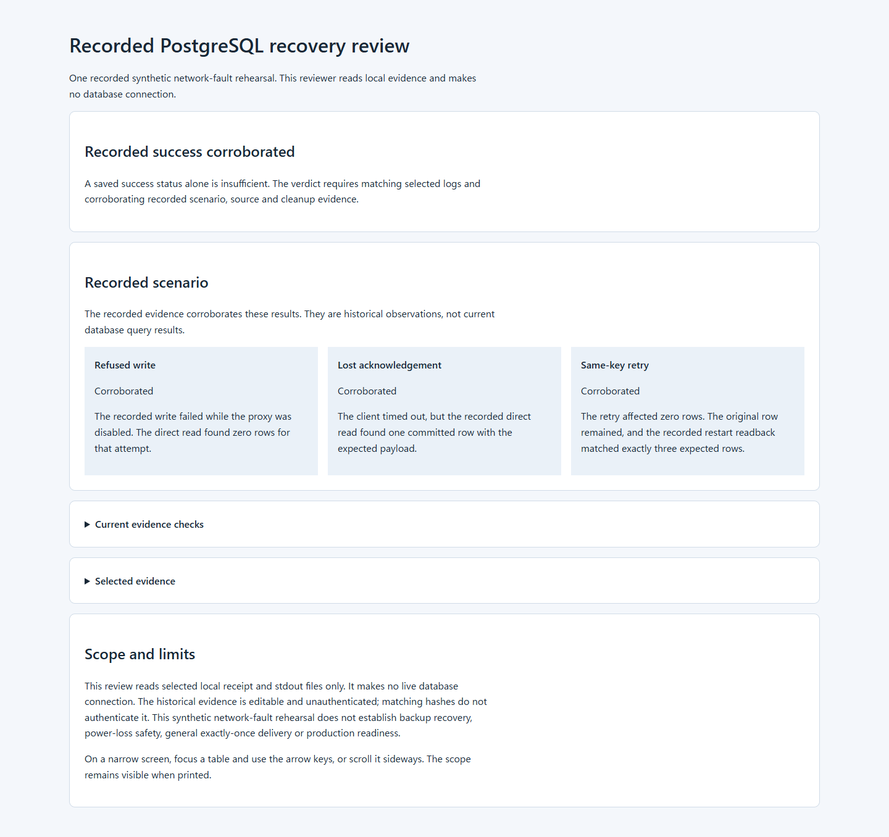

# PostgreSQL recovery rehearsal

[](https://github.com/skyon0522-ai/postgres-recovery-kit/actions/workflows/checks.yml)

A database timeout does not tell you whether a write committed. Run a local network-fault rehearsal that distinguishes a refused write from a committed write whose reply was lost, then inspect the evidence in an offline report.



The fixed example uses PostgreSQL, Toxiproxy and a go-pg connection pool. It runs against a new synthetic cluster, stops its owned services and retains the data and logs. It accepts no existing-database URL or credentials.

[Run on Linux](#run-on-linux) · [Recorded examples](#recorded-examples) · [Inspect the result](#inspect-the-result) · [Implementation](#implementation) · [Verification](#verification) · [Limits](#limits)

## Run on Linux

Use a non-root Linux account, Python 3.12, `ss` from iproute2, Go **1.27.2** and PostgreSQL **18.6**. Tools must already be installed; see [Linux setup and operation](docs/linux.md) for version checks, official installation references and explicit tool paths.

With `go` and `pg_config` on PATH, run from this repository:

```sh
python3 -B tools/run_rehearsal.py \
  --output-dir "$HOME/.cache/postgres-recovery-kit/run-$(date +%s)"
```

The command locates the tools, invokes the existing source-checked rehearsal, then prints a JSON record with the `receipt` and `report` paths. Open that `report.html`. No web server, API key or Python package installation is needed. Each run requires a new native Linux output directory outside the checkout; an existing output is refused.

The first run acquires Go modules through the original proxy/checksum route. To reuse a populated verified cache without network downloads, add `--module-cache /absolute/path/to/modules --offline`. Build failures preserve logs and cannot produce a successful review. See [the operating guide](docs/linux.md) for failed/interrupted runs and exit codes.

## Recorded examples

| Example | What was observed |
| --- | --- |
| [Completed rehearsal](examples/completed/report.html) | A real local test distinguished refusal from lost acknowledgement; same-key retry affected zero rows, the exact three-row set survived a clean restart, and owned services stopped. |
| [Failed offline build](examples/failed-build/report.html) | An incomplete offline module cache stopped the real build before any service started. The report marks the scenario as uncorroborated. |
| [Changed inspection evidence](examples/changed-evidence/report.html) | One log line was changed in a separate inspection copy while the saved receipt still said success. Hash and ordered-event checks reject it. This is a diagnostic control, not another database run. |

These are static inspection outputs containing selected checks and hashes. Raw logs, local paths, ports, credentials and database values are not distributed with them. GitHub may show HTML source; download the example's three files together and open `report.html` locally.

## Inspect the result

The report separates the current evidence checks from the historical database observations. A saved success string alone is insufficient: the selected step exits, stdout hashes, ordered test events, source checks, exact final rows, restart and recorded cleanup must agree.

| Situation | Client sees | Independent observation in this fixed test |
| --- | --- | --- |
| Proxy disabled | Connection/write error | Zero rows for that write |
| Reply dropped after commit | I/O timeout | One committed row with its expected payload |
| Same key retried after recovery | Zero affected rows | Original row preserved; exact three-row set after a clean restart |

To inspect an existing receipt again, use the [read-only review command](docs/linux.md#read-a-recorded-result-again). It makes no database connection and adds no automatic write retry. The report has a narrow-screen layout, keyboard-accessible details and tables, JSON links and print-visible scope.

## Implementation

| Path | Responsibility |
| --- | --- |
| [tools/run_rehearsal.py](tools/run_rehearsal.py) | Linux tool discovery, exclusive new work directory, original-runner invocation and retained failure output |
| [tools/verify_recovery.py](tools/verify_recovery.py) | Existing real server build, synthetic cluster, selected test, restart readback and cleanup |
| [recovery-improvement/example/recovery_test.go](recovery-improvement/example/recovery_test.go) | Actual proxy faults, same-pool recovery, direct observer and keyed SQL retry |
| [tools/review_run.py](tools/review_run.py) | Bounded read-only evidence inspection and static report |
| [tools/verify_source.py](tools/verify_source.py) | Original component/adapter source-byte and license guard |
| [docs/linux.md](docs/linux.md) | Setup, commands, outcomes and failure inspection |

Go continues to run the network-fault test and copied server. The new Python interface reuses the existing standard-library coordination and the Backup Restore Drill report pattern; it adds no dependency or database-recovery implementation. [DESIGN.md](DESIGN.md) explains the boundary. [RESEARCH.md](RESEARCH.md) maps the acknowledgement failure window to its inspected CIDR 2007 position paper.

<details>
<summary>Source and required notices</summary>

[PROVENANCE.md](PROVENANCE.md), [source-copy-manifest.json](source-copy-manifest.json), [LICENSE](LICENSE), the component notices and the existing adaptation records identify the exact reused source and changes. The 87 copied component files, eight protected Go adapter files, dependency locks, original runner and source guard remain unchanged in this increment.

</details>

## Verification

On 2026-10-15, Ubuntu 24.04 x86_64 with existing Go 1.27.2 and PostgreSQL 18.6 passed the actual native rehearsal after normal module acquisition into an initially empty run-local cache. Both module-verification steps passed. A second new cluster exercised the new entrypoint with PATH discovery, an output path containing spaces/Japanese text and the newly populated cache offline. All owned services stopped and all protected source hashes matched.

The new Python tools passed **28 tests**. The three actual report variants passed desktop/mobile JSON agreement, keyboard, local-link, print-scope and reduced-motion checks. [VERIFICATION.md](VERIFICATION.md) and [the Linux record](verification/linux-review-20261015.json) distinguish the native executions, protocol unit tests, diagnostic copy and rendering checks.

Historical [CI run 38060138489](https://github.com/skyon0522-ai/postgres-recovery-kit/actions/runs/38060138489) succeeded at base `6bec69644d0744d30844820a9b4c4f3c775d6aae`. The changed workflow is prepared for source checks, Python tests, server build and test compilation. Its new-commit remote run is unperformed; it does not execute the database scenario.

## Limits

This is one sequential synthetic network-fault scenario with loopback trust authentication. Records are editable and unauthenticated; the viewer does not report the database's current state. Clean-restart survival does not establish crash or power-loss recovery, general exactly-once execution, concurrent replay safety, failover, load capacity or production readiness.

The five-second acceptance bound applies to each same-pool recovery check, not the entire command. A fresh OS/PostgreSQL installation and the full upstream suite remain unverified. The original schema/seed functions and retained latency/reset tests compile but are not selected. Run the documented entrypoint rather than the retained `main.go`, which has upstream port/database assumptions. See [SECURITY.md](SECURITY.md) for data, permissions, interruption and problem reporting.
